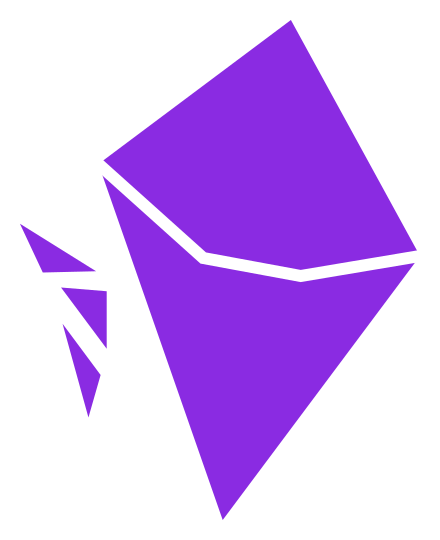

# Amethyst

**The ADE built for managing agent chats.**

[Join the Discord](https://discord.gg/yppAbHmMXG) for help, feedback and news.

Amethyst is an ADE (Agentic Development Environment) for software engineers. Run your coding agents in
parallel on your own accounts, give every task its own space, and switch projects in one click while every agent
keeps working. Arrange the window around the work, from a wall of chats to chats beside your code, with orchestration
and context passing between agents built in.


## Why Amethyst

Amethyst is built in Amethyst. A couple of days after it first ran, I moved my work on it inside it, and I've built it
there ever since. I like working in lots of small chats: an idea, a fix, a question that comes up mid-task each gets
its own chat right away, and I come back to it when I'm ready. The tools I used before could hold a few, but launching
that many and keeping them in order was a fight. Amethyst is the tool I wanted for that.

## Features

### Chat management

- **Agent decks.** Give each line of work its own set of live chats, and switch between sets as your focus moves. The
  ones waiting for you are always listed first.
- **The bench.** Put the chats that can wait on the bench. They keep running out of view, and you take them back one
  at a time when you're ready.
- **Every chat kept.** Your chats stay listed after they leave the view and come back after a restart. Sessions you
  started in a terminal open here too.

### Every project in one place

Your projects sit in a dock at the bottom. One click switches, and the agents in the project you left keep working.
When one window isn't enough, open a second one or a Quick Window, and each project remembers its own.

### The window you want

Fill the window with chats, put them beside your code, or follow one chat with its subagents in tabs. Right-click
anything you don't use to hide it for good, and pick from five themes, any accent colour and your own shortcuts. If
something still gets in your way, ask for a switch on Discord or in the issues.

### Orchestration

Ask one chat to split a job, and it starts other chats, gives them work, waits for them and reads their answers. You
can do the same from a terminal with the `amethyst` command, and agents outside Amethyst can join in through its MCP
server.

### Context passing

Switch a chat from one agent to another midway, and the conversation goes with it.

### Multiple Claude accounts

Switch accounts in one click, and see every account's limits and reset times.

### Unreal Engine C++ (beta)

Turn it on in settings, and Amethyst builds your project with the engine it names, shows errors in your C++ as you
type, and gives you a debugger your agents can drive. Testers needed: say what's missing on
[Discord](https://discord.gg/yppAbHmMXG).

### Also in it

A code editor with splits and tab groups, real terminals, git, rewind with file checkpoints, edit review, a worktree
per chat, a browser tab, a scratch pad on `alt s`, a quick terminal, an inbox, clips, don't forget, and a freeze log.

## Supported agents

Amethyst runs each agent on your own account, signed in the way you choose:

- **Claude:** your Claude Code plan, an API key, a Console account, Amazon Bedrock, Google Vertex or Microsoft
  Foundry.
- **Codex:** your ChatGPT plan through `codex login`, or an API key.
- **Antigravity:** your Google account or a Gemini API key.
- **Cursor:** your Cursor CLI sign-in, or an API key.
- **GitHub Copilot:** your Copilot CLI sign-in, or a GitHub token.

## Guides

- [All guides](docs/README.md): getting started, modes and shortcuts, agent setup and multi-account Claude, edit review and rewind, worktrees and context handoff, git/GitHub, and the Unreal debugger.
- [Agents from other models as subagents](docs/agents.md): start Claude, Codex, Antigravity, Cursor, or GitHub Copilot as a subagent from inside any chat.
- [Driving other chats (orchestration)](docs/orchestration.md) and [CLI and MCP server](docs/cli-and-mcp.md).
- [Command and MCP reference](docs/commands.md): complete reference of every `amethyst` command, flag, and MCP tool.

## Download

Get `Amethyst-Setup-<version>.exe` from the latest release on this repo's [Releases](../../releases/latest) page. Run
it and accept the [license](LICENSE).

The installer isn't signed yet, so Windows SmartScreen may say it protected your PC. Click **More info**, then
**Run anyway**.

You may share links to this page, [amethyst.run](https://amethyst.run) and the
[Amethyst Discord](https://discord.gg/yppAbHmMXG). Please don't re-host the installer.

## What it needs

- Windows 10 or 11. That's all Amethyst itself needs: the editor, the terminals, the board and your projects work
  without any account or subscription.
- To use agents, at least one of these, installed and signed in with your own account:
  - [Claude Code](https://code.claude.com/docs/en/getting-started), or an API key entered in the Claude Agent tab;
  - the [Codex CLI](https://developers.openai.com/codex/cli);
  - the Antigravity CLI;
  - the Cursor CLI;
  - the GitHub Copilot CLI.

## Updates

Amethyst updates itself from this repo's releases. Its settings show when a new version is out. What changed is in
each release's notes on the [releases page](https://github.com/devdelion-one/Amethyst/releases).

## Source available

All of Amethyst's code is here, so you can see exactly what runs on your PC, including what the agents can do. The
installer ships the same plain, readable files. Amethyst is source available, not open source: anyone may read the
code, but using it needs a license.

- Right now Amethyst is in beta and free, for personal and work projects. You can't buy a license yet: there is
  nothing to pay.
- The day 1.0.0 comes out, licenses go on sale: Personal (one person, all your own computers, not for paid work)
  and Commercial (per person, for paid work or use in a company). Prices are set then.
- 30 days after 1.0.0 the beta ends. From then on every version needs a paid license, the beta versions too: an
  older version doesn't stay free.
- A license covers Amethyst only while it's paid for. When it ends, you stop using every version, including the
  ones you downloaded or built while it was paid, until you renew.
- Students and maintainers of open-source projects can ask for a free license at support@amethyst.run.
- You may change Amethyst and build it for yourself, but not share, publish or sell builds of it, changed or not.

The full terms are in [LICENSE](LICENSE).

- [PRIVACY.md](PRIVACY.md): what the app and the website send and keep.
- [THIRD-PARTY-NOTICES.txt](THIRD-PARTY-NOTICES.txt): the licenses of the open-source parts.

## From source

You need [Node.js](https://nodejs.org) 22.18 or later. In this repo's folder:

```powershell
npm install
cd desktop
npm install
cd ..
npm run desktop
```

## Contributing

Issues, bug reports and ideas are welcome. Code pull requests aren't accepted for now. See
[CONTRIBUTING.md](CONTRIBUTING.md).

## Help and bugs

Ask and report on the [Amethyst Discord](https://discord.gg/yppAbHmMXG). [docs/SUPPORT.md](docs/SUPPORT.md) says what
to include in a bug report, and [docs/SECURITY.md](docs/SECURITY.md) how to report a security problem privately.
